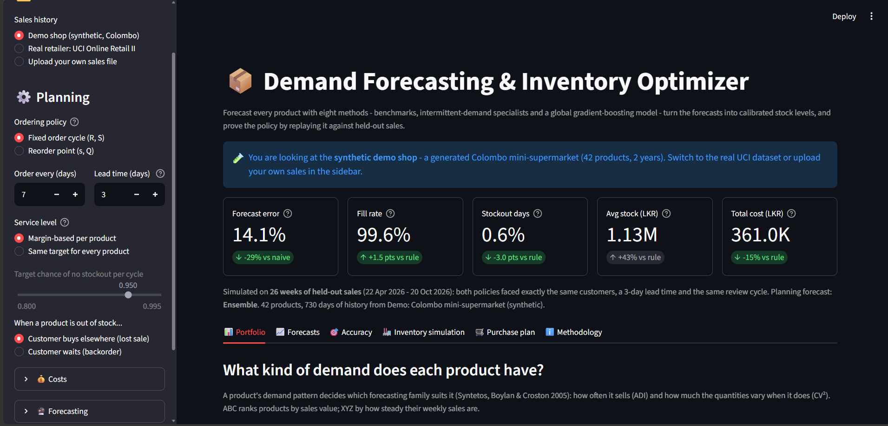
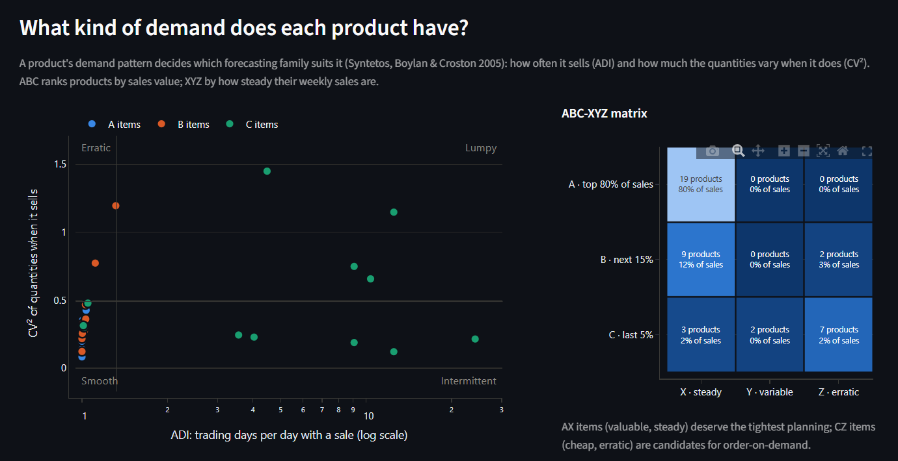
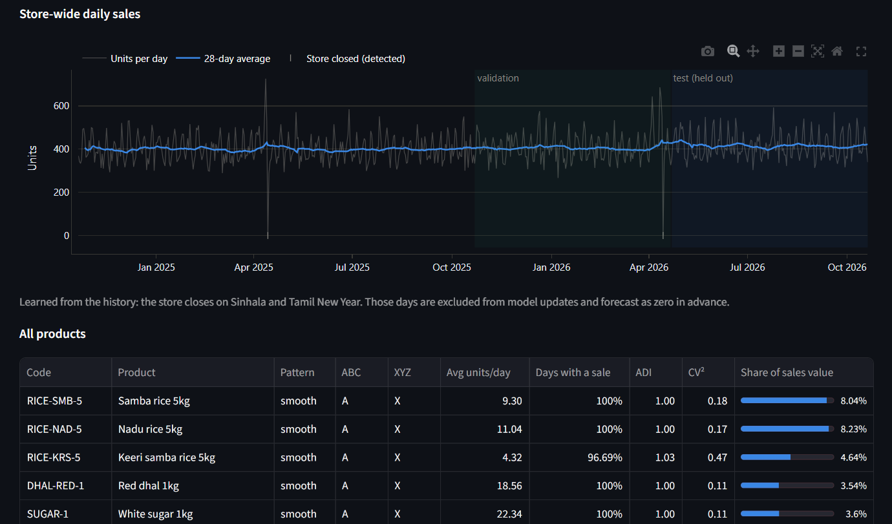
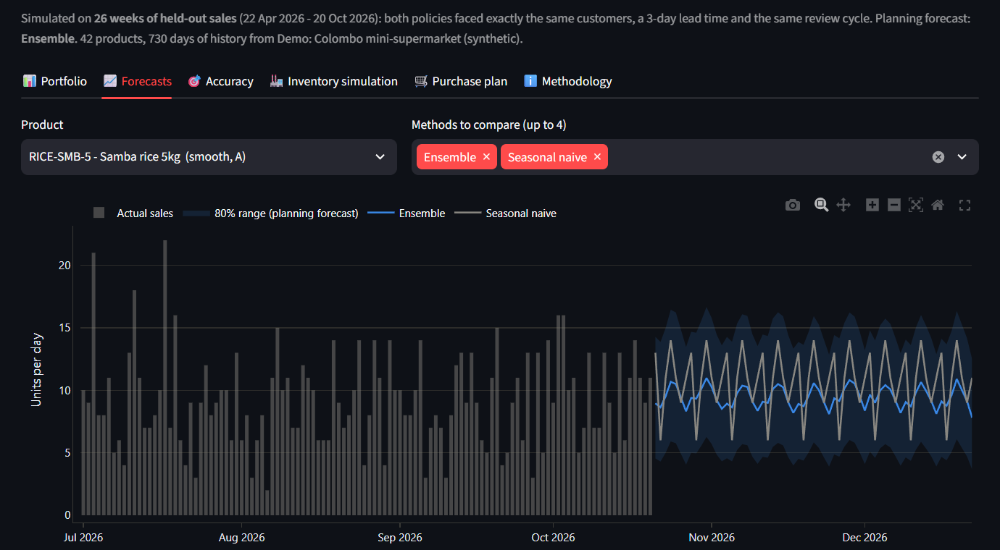
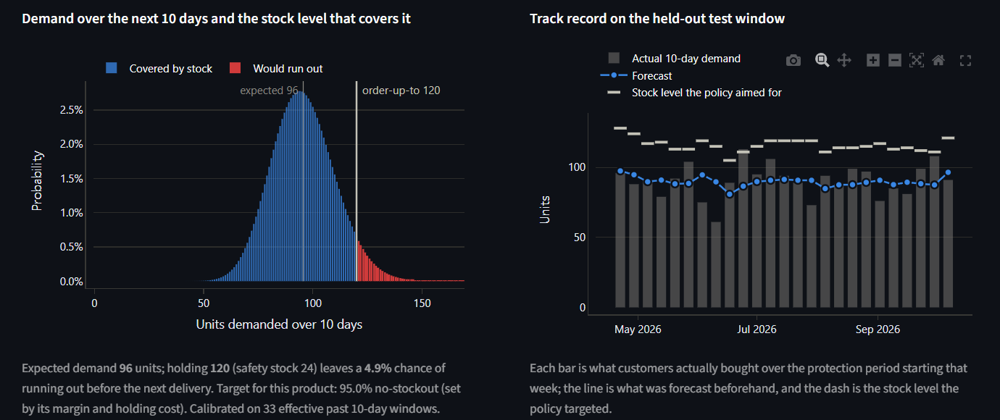
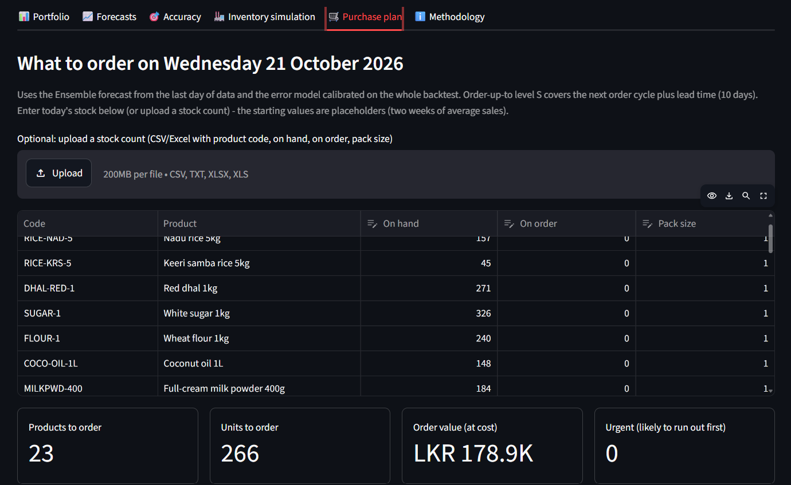

<div align="center">

# 📦 Demand Forecasting & Inventory Optimizer

**How much of each product should a shop reorder this week?**<br>
Forecasts every product's demand, turns the forecasts into stock levels, writes today's purchase order,<br>
and proves the policy by replaying it against sales it has never seen.




</div>

## The problem

Most small and mid-sized shops reorder by habit: *"same as last month"* or *"keep two weeks of stock"*. That rule treats
a bag of rice and a Christmas cake the same way, ignores holidays, and has no idea how uncertain its own guesses are.
The result is empty shelves on fast-moving products and cash tied up in slow ones, at the same time.

Large retailers solve this with expensive demand-planning software. This app runs the same kind of pipeline on any
sales export from a POS, ERP or accounting system. It measures what the plan *would have saved* instead of just
claiming it.

## Results

Each policy is replayed day by day on held-out sales. The optimised policy is compared with the usual rule of thumb:
*order up to 10 days of recent average sales + 20%*.

| Held-out test window | Demo shop: Colombo mini-supermarket<br>(26 weeks, synthetic) | Real data: UK online wholesaler<br>(13 weeks, UCI Online Retail II)\* |
|---|:---:|:---:|
| Forecast error over the protection period, best method vs naive benchmark | **14.0%** vs 19.9% (−30%) | **43.3%** vs 53.6% (−19%) |
| Fill rate, optimised vs rule of thumb | **99.7%** vs 98.1% | **95.0%** vs 82.7% |
| Product-days with a stockout | **0.6%** vs 3.6% | **2.1%** vs 12.4% |
| Total cost (holding + ordering + stockouts) | **−15%** | **−61%** |
| Revenue lost to stockouts | **−87%** | **−75%** |
| Average stock held | +44% | +179% |

The optimiser holds *more* stock than the rule because, at these margins, a lost sale costs far more than a week of
storage. Compared with the rule of thumb at its *best* buffer, which you only know in hindsight, the saving is smaller:
about 6-8% of total cost in development runs.

<sub>\* The UCI figures were measured during development on the 2010-2011 half of the dataset (one year of history). The demo
shop is generated up to the current date on every run, so its figures move by a few tenths of a percent between days
and machines.</sub>

## Screenshots

| | |
|:---:|:---:|
| **Demand patterns & ABC-XYZ classification** | **Store-wide sales with detected closures** |
|  |  |
| **Forecasts with an 80% prediction band** | **Demand risk and the forecast's track record** |
|  |  |

<div align="center">

**Today's purchase order**



</div>

## What it does

- **📊 Portfolio:** classifies every product by demand pattern (smooth, erratic, intermittent or lumpy) and by
  ABC-XYZ. Detects store closures automatically, such as "closes on Sinhala and Tamil New Year".
- **📈 Forecasts:** each product's 63-day forecast from up to four methods, with an 80% prediction band. Shows the
  probability of running out over the next delivery period and how past forecasts compared with what actually sold.
- **🎯 Accuracy:** a rolling-origin backtest leaderboard (MASE, RMSSE, WAPE, bias, value added vs the benchmark), plus
  a calibration check: when the model says "95% chance demand stays below this level", how often was it right?
- **🏭 Inventory simulation:** replays the optimised policy and the rule of thumb day by day. Reports fill rate,
  stockout days, stock value, costs and an efficient frontier of stock invested vs service delivered.
- **🛒 Purchase plan:** enter or upload today's stock count and get order quantities, order value, safety stock, the
  risk of running out before delivery, and a purchase order to download (CSV).

**Three data sources:**
- **Demo shop (synthetic):** a Colombo mini-supermarket with 42 products over 2 years. It includes salary days,
  Avurudu build-up and closure, Vesak, school terms, monsoon umbrellas, unannounced promotions, a product launch and a
  product dying out.
- **Real data:** UCI Online Retail II, with 1,067,371 transactions from a UK online wholesaler. The app downloads it
  once (about 45 MB).
- **Your own file:** any CSV or Excel sales export. Columns are recognised automatically.

## Quick start

```bash
git clone https://github.com/harshadulshan/demand-inventory-optimizer.git
cd demand-inventory-optimizer
pip install -r requirements.txt
streamlit run app.py
```

The demo works offline. The first run trains the models and takes 15-60 seconds; after that, changing settings is
instant. For the real dataset, choose **Real retailer: UCI Online Retail II** in the sidebar and click **Download and
prepare the dataset**. Preparation takes about 1-2 minutes, or about 15 seconds with `pip install python-calamine`.

## Using your own data

Upload transaction lines or daily totals with at least these columns:

| Needed | Column names it recognises (any case) |
|---|---|
| **Date** | Date, Bill Date, Invoice Date, Order Date, Transaction Date |
| **Product code** | SKU, Item Code, Product Code, Barcode, StockCode |
| **Quantity sold** | Qty, Quantity, Units, Qty Sold |
| Unit selling price *(optional)* | Price, Unit Price, Selling Price, MRP |
| Unit cost *(optional)* | Cost, Unit Cost, Cost Price, Purchase Price |
| Product name *(optional)* | Description, Item Name, Product Name |

- **Returns** can be negative quantities; they are netted per day.
- **Dates** in day-first format (dd/mm/yyyy, the Sri Lankan convention) are detected automatically.
- **History:** at least about 5 months is needed. A year or more lets the ML model learn yearly seasonality.

`sample_data/` has two files to try the upload flow end to end:
- `sample_pos_export.csv`: a POS-style export with 36,617 bill lines, 12 products, 18 months and returns.
- `stock_count_template.csv`: a matching stock count.

## How it works

<details>
<summary><b>Forecasting: 8 methods, no peeking at the future</b></summary>

<br>

| Method | What it is |
|---|---|
| Seasonal naive | Last observed same weekday. This is the benchmark every method must beat. |
| Moving average (28d) | Mean over trading days in the last 28 days. |
| SES | Simple exponential smoothing, with alpha chosen per product. |
| Croston-SBA | Croston (1972) with the Syntetos & Boylan (2005) bias correction, for intermittent demand. |
| TSB | Teunter, Syntetos & Babai (2011). It smooths the probability of a sale, so it notices a product dying out. |
| Theta | SES with drift (Hyndman & Billah 2003) on weekday-adjusted demand. |
| Global ML | One scikit-learn `HistGradientBoostingRegressor` (Poisson loss) trained across all products, with lags, rolling statistics, weekday, holidays and last-year features. It predicts demand relative to each product's recent level, because trees cannot extrapolate a seasonal surge. |
| Ensemble | Equal-weight mean of Theta, TSB and the ML model. |

Closed days are skipped by every method rather than treated as zero demand. Days known in advance to be closed, such
as learned holiday closures, are forecast as zero.

The backtest uses weekly forecast origins over a validation window and a test window. The ML model is retrained every
13 weeks on past data only. "Auto" picks, per product, the method with the smallest error over the *protection
period* (review cycle + lead time), because that is the error that sizes safety stock.

</details>

<details>
<summary><b>From forecast to stock level: calibrated uncertainty</b></summary>

<br>

- **Demand over the next P days** is modelled from the planning method's *own past P-day errors*. It uses a
  bias-corrected mean and an over-dispersed Poisson variance.
- **Past windows are weighted** by recency and by how similar their forecast level was to today's. A seasonal
  product's off-season risk is therefore not judged by its peak-season errors.
- **Quantiles** come from a negative binomial, or distribution-free from weighted split-conformal prediction
  (Barber et al. 2023).
- **The order-up-to level** S (or the reorder point s with EOQ) is set at the target service level. That target is
  either one value for all products or cost-optimal per product, using the newsvendor critical ratio `B / (B + h·R)`.

</details>

<details>
<summary><b>Simulation</b></summary>

<br>

Each morning, deliveries arrive and stock is reviewed. Orders are placed, rounded up to pack size, and arrive L days
later. The day's real demand is served from stock; anything left unserved is either lost or backordered. Both
policies face exactly the same customers.

</details>

## Verification

```bash
pip install statsmodels     # used only as an independent reference in the tests
python tests/verify_engine.py
```

The 15 checks cover:
- **Forecasting methods:** SES and Theta match statsmodels exactly, and Croston, SBA and TSB match reference loops.
- **No lookahead:** scrambling every observation after a forecast origin leaves every method's forecast unchanged,
  including the ML model and its features.
- **Stock levels:** the critical-ratio order-up-to level matches brute-force cost minimisation by simulation.
- **Calibration:** with correct forecasts, stated 80/90/95% coverage is achieved within 3.5 points.
- **Simulator:** stock is conserved.
- **Data layer:** day-first dates, POS column guessing, returns netting, UCI cleaning, and closure learning.

The suite was itself tested by planting bugs, such as a one-day leak in an ML feature and a wrong critical ratio.
Each one was caught.

## Limitations

1. **Sales are not demand.** While a product is out of stock, recorded sales understate what customers wanted.
2. **No promotions, prices or weather as inputs.** The demo contains promotions the models are never told about, as
   in most small shops' data.
3. **Fixed lead times and unlimited supplier capacity.** Expiry, budget and shelf-space limits are not modelled.
4. **With only one year of history,** the ML model cannot learn yearly seasonality and under-forecasts sudden surges.
5. **Short test windows from one business at a time.** This is a methodology demonstration on real data, not a
   validated commercial system.

## Project structure

```
demand-inventory-optimizer/
├── app.py               # Streamlit dashboard (UI + charts)
├── forecasting.py       # Demand classification, 8 forecasting methods, ML model, backtest, metrics
├── inventory.py         # Calibrated demand distribution, service levels, policies, simulation, purchase plan
├── data_sources.py      # Demo shop generator, UCI download & cleaning, upload parsing
├── calendar_utils.py    # Holiday calendars, store-closure detection, learned holiday closures
├── tests/verify_engine.py
├── sample_data/         # POS export and stock count to try the upload flow
└── docs/screenshots/
```

## Tech stack

Python · Streamlit · pandas · NumPy · SciPy · scikit-learn · Plotly · `holidays` (Sri Lankan and other public
holiday calendars)

<details>
<summary><b>Data sources & references</b></summary>

<br>

- **UCI Online Retail II:** Chen, D. (2019), UCI Machine Learning Repository, CC BY 4.0.
  https://archive.ics.uci.edu/dataset/502/online+retail+ii
- **Public holidays:** the `holidays` package, https://github.com/vacanza/holidays
- **Forecasting:**
  - Croston (1972) *Operational Research Quarterly* 23
  - Syntetos & Boylan (2005) *Int. J. Forecasting* 21
  - Syntetos, Boylan & Croston (2005) *J. Oper. Res. Soc.* 56
  - Teunter, Syntetos & Babai (2011) *EJOR* 214
  - Hyndman & Billah (2003) *Int. J. Forecasting* 19
  - Hyndman & Koehler (2006) *Int. J. Forecasting* 22
  - Makridakis, Spiliotis & Assimakopoulos (2022), "M5 accuracy competition", *Int. J. Forecasting* 38
- **Uncertainty and calibration:**
  - Barber, Candès, Ramdas & Tibshirani (2023), "Conformal prediction beyond exchangeability", *Annals of Statistics* 51
- **Inventory:**
  - Silver, Pyke & Thomas (2017), *Inventory and Production Management in Supply Chains*, 4th ed.

</details>

## Author

**Harsha Dulshan**, BSc in Management Information Systems (Special), NSBM Green University ·
[LinkedIn](https://www.linkedin.com/in/harsha-kaldera/) · [GitHub](https://github.com/harshadulshan)

Released under the [MIT License](LICENSE).
